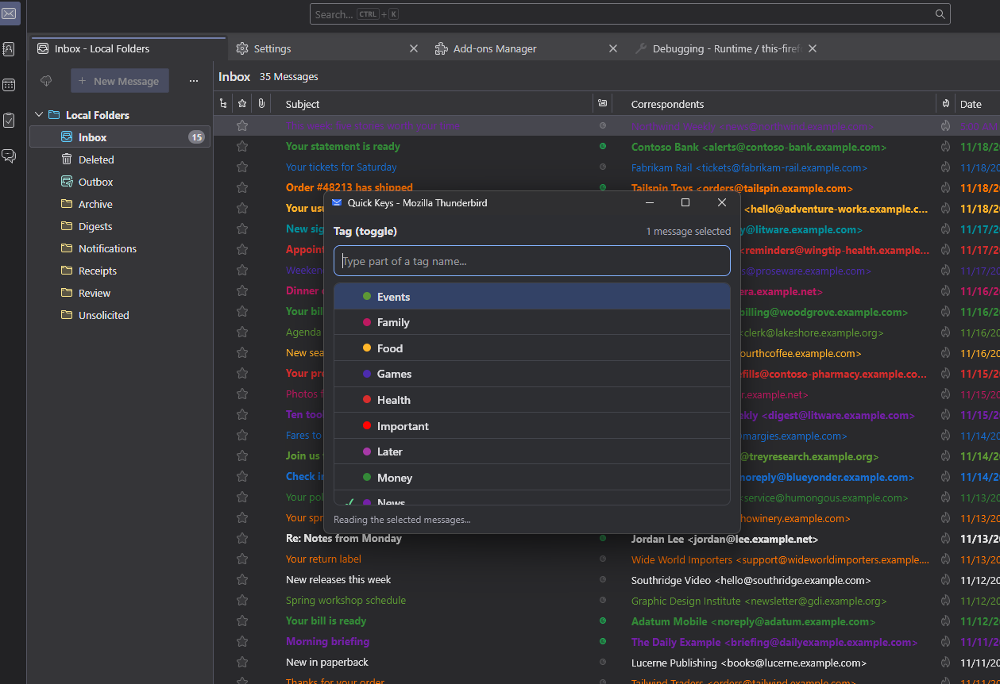
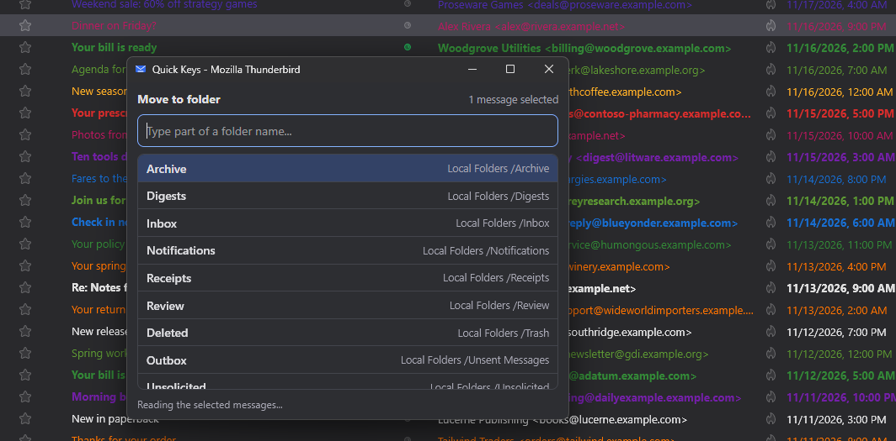
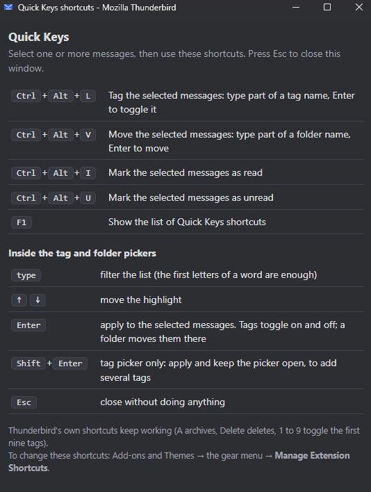

# Quick Keys: Tag, Move, Mark

Keyboard shortcuts for fast inbox triage in Thunderbird. Select some messages, press a shortcut, **type a few letters, press Enter**. No mouse needed.

## What it does

| Default shortcut | Action |
|---|---|
| **Ctrl+Alt+L** | **Tag picker.** Type part of a tag name and press **Enter** to toggle that tag on the selected messages. Tags the messages already have are ticked. **Shift+Enter** applies the tag and keeps the picker open, so you can add several. |
| **Ctrl+Alt+V** | **Move picker.** Type part of a folder name and press **Enter** to move the selected messages there. Recently used folders are listed first. |
| **Ctrl+Alt+I** | Mark the selected messages as **read**. |
| **Ctrl+Alt+U** | Mark the selected messages as **unread**. |
| **F1** | Show a list of the current shortcuts. |

Inside either picker: type to filter (the first letters of a word are enough), **Up/Down** to move the highlight, **Enter** to apply, **Esc** to cancel.

**Large selections:** a shortcut acts on up to 10,000 selected messages. If you select more than that (Ctrl+A on a huge folder, say), only the first part of the selection is used. Messages are read in pages, so the actual number can run a little over 10,000. The limit is the `MAX_MESSAGES` constant at the top of `background.js`.

Thunderbird's default shortcuts are untouched, and in fact are intended to work with this add-on. For example, **A** archives, **Delete** deletes, **T** jumps to the next unread thread, **arrow keys** move up and down, and **1 to 9** toggle the first nine tags. I didn't want to replace that functionality with Quick Keys, just expand on it: any tag by name (I did not want to memorize tags by number), any folder by name.

## Customizing

- **Change a shortcut:** Add-ons and Themes, the gear menu, **Manage Extension Shortcuts**. The F1 window always shows the keys you currently have.
- **Options** (Add-ons and Themes, Quick Keys, Preferences):
  - keep the tag picker open after applying a tag;
  - only offer folders from the same account as the selected messages.

## Install

- From the Thunderbird add-ons site (once published).
- Or from source, to try it: Tools, Developer Tools, **Debug Add-ons**, **Load Temporary Add-on**, choose `manifest.json`. A temporary add-on is removed when Thunderbird restarts.

Requires Thunderbird 140 or later. It has only been tested on Thunderbird 160. The folder and tag APIs it uses first appeared in Thunderbird 121, so it cannot work on anything older, and 140 (the current Extended Support Release when this was written) is the oldest version I am willing to claim.

## Why the shortcuts have a modifier key

Thunderbird's extension shortcut system does not allow plain letters (function keys are the exception), so single-key shortcuts like Gmail's are not possible for a standard add-on. The defaults use **Ctrl+Alt+letter** because Alt+letter combinations collide with Thunderbird's menu access keys (Alt+V opens the View menu, for example) and Alt+Shift combinations were ignored in the message list during testing.

## Troubleshooting

- **A shortcut does nothing:** check Manage Extension Shortcuts for a conflict or an empty field. After reinstalling the add-on you may need to set the keys again.
- **The picker says it can't see any messages:** click a message in the list first. It works with a message selected in the list and with a message open in its own tab or window.
- **F1 opens Thunderbird's Help instead:** rebind "Show the list of Quick Keys shortcuts" in Manage Extension Shortcuts.

## Privacy

Nothing leaves your computer. The add-on makes no network requests and collects no data. It stores two settings and the ids of up to eight recently used folders in Thunderbird's local add-on storage. See [PRIVACY.md](PRIVACY.md).

## Permissions, and why

| Permission | Why |
|---|---|
| `accountsRead`, `accountsFolders` | list your folders for the move picker |
| `messagesRead` | see which messages are selected, and their tags |
| `messagesMove` | move messages |
| `messagesUpdate` | mark read or unread; set tags |
| `messagesTags`, `messagesTagsList` | list your tags |
| `storage` | save the two settings and the recent-folder list |

It uses only Thunderbird's standard WebExtension APIs: no privileged code, no network access.

## Development

Quick Keys was co-developed with Claude Code (Anthropic's AI coding assistant). I directed the design and reviewed and tested all of the code, and Claude wrote most of it.

Plain JavaScript, no build step, no dependencies. The files in this folder are the add-on. To package it, zip `manifest.json`, `background.js`, `picker.html`, `picker.js`, `help.html`, `help.js`, `options.html`, `options.js`, `icon.svg`, `README.md`, `PRIVACY.md` and `LICENSE`.

## License

MIT. See [LICENSE](LICENSE).
